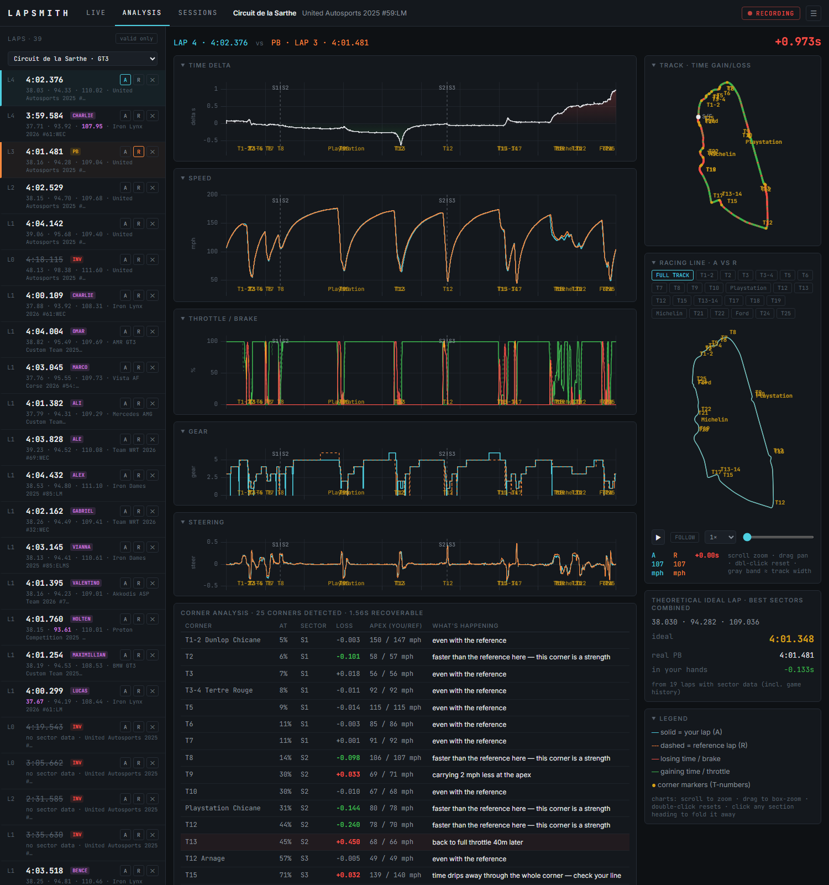

# Lapsmith

**Forge better laps.** A free, open-source telemetry platform for sim racing —
record every lap you drive, see corner-by-corner where the time is lost, and
watch any two laps race each other as ghosts.



## Why Lapsmith

Most drivers know *that* they're slow somewhere. Telemetry tools show you
*where*. Lapsmith goes one further and tells you *why* — in plain English:

> **T4-5 Variante della Roggia · +1.427s** — carrying 11 km/h less at the
> apex; back to full throttle 16m later

## Features

- **A coach that learns from your driving** — gradient boosting (scikit-learn)
  fits corner time against your braking point, minimum speed, and throttle
  application across every lap you've driven, then measures each habit
  counterfactually: *"T1 — carry 1mph more minimum speed ≈ 0.12s."* A second
  tier benchmarks your best corner against the fastest driving ever recorded
  there, captured rival laps included
- **Corner-by-corner analysis** — corners detected automatically from the
  geometry of your driven line, matched to their real names, each scored
  with time lost/gained, braking point, apex speed, and throttle comparison
- **ABS detection** — wheel-pressure flutter reveals when the anti-lock is
  working; those moments glow amber on the brake trace, in the app and the
  overlay
- **Ghost playback** — two laps replay on a shared clock around the track
  map; scrub, slow-mo, and watch exactly where the reference pulls away
- **Racing line comparison** — both driven lines overlaid inside the real
  track corridor, zoomable per corner
- **Time-delta analysis** — the classic delta curve plus speed / pedals /
  gear / steering traces on a synced distance axis with sector and corner
  markers, value chips riding the crosshair, and both maps tracking your
  cursor; every section folds away and remembers it
- **Full lap history** — imports your past lap and sector times straight
  from the game's own session logs, back to your first drive
- **Personal bests & the ideal lap** — PBs tracked per track + car, plus a
  theoretical best from your fastest sectors combined
- **Session library** — every stint grouped by track, color-coded by
  session type, purple-highlighted best sectors
- **Cut-lap protection** — laps the sim refuses to count (track cuts,
  resets, quitting mid-lap) can never become your PB
- **Runs 100% locally** — your data stays on your machine, in an open
  SQLite + NumPy format you can inspect yourself

## Supported sims

| Sim | Status |
| --- | ------ |
| Le Mans Ultimate | ✅ supported (shared memory, live + history import) |
| iRacing | 🔜 planned — adapter architecture is ready |
| Assetto Corsa Competizione | 🔜 planned |
| Assetto Corsa | 🔜 planned |

Adding a sim means writing **one adapter** (~150 lines): everything else —
recording, analysis, UI — is sim-agnostic. Contributions welcome.

## Quick start

```powershell
git clone https://github.com/tatewamola-web/lapsmith
cd lapsmith
# engine (Python 3.10+)
uv venv engine\.venv && uv pip install -e engine --python engine\.venv
# ui (Node 20+)
cd ui && npm install && npm run build && cd ..
# run — opens http://localhost:8000
./scripts/lapsmith.ps1              # Le Mans Ultimate
./scripts/lapsmith.ps1 -Adapter sim # demo mode, no game needed
```

For LMU: enable **Settings → Gameplay → Enable Plugins**, then drive.
Details in [docs/SETUP_LMU.md](docs/SETUP_LMU.md).

## How it works

```
┌──────────────┐             ┌──────────────┐              ┌──────────────┐
│ game adapter │ ─ frames ─► │    engine    │ ─ REST/WS ─► │  UI/overlay  │
│  (LMU, sim)  │   (50 Hz)   │ record+math  │              │    React     │
└──────────────┘             └──────────────┘              └──────────────┘
```

Laps are compared **by track position, not by time**, so corners line up
between any two laps — the same principle professional motorsport telemetry
uses. SQLite stores the facts (one row per lap: times, sectors, car, class,
validity) because facts want to be queried; NumPy holds the waveforms
(~5,000 samples × 13 channels per lap) because signals want to be
transformed. The full build story, including every bug reality threw at us,
lives in [DEVLOG.md](DEVLOG.md).

Track corner names self-calibrate: a track seeded from a public map corrects
itself the first time you drive it, whenever detection finds exactly as many
corners as the name list holds.

## In-game widgets

Open the **Widgets** tab in the app: each widget has an on/off switch and its
settings in one place. Each widget is its own transparent always-on-top
window over the game (set the game to borderless-windowed): drag anywhere,
resize from a corner to scale, and it remembers where you left it. Settings
changed in the hub reach open widgets within a few seconds; switching one
off closes it.

- **Corner Callouts** — one short instruction per corner as you approach it,
  e.g. *"T1 · Brake slightly later, throttle sooner"*, distilled from the
  coach (your own habits + the fastest driving recorded at that track).
  Adjustable lead distance.
- **Delta Bar** — iRacing-style live gap to your reference lap. The bar fills
  green (ahead) or red (behind) from the center; the number turns green while
  you're gaining *right now*. Adjustable range, bar/number toggles.
- **Input Trace** — rolling throttle/brake trace against the reference lap
  with your live inputs on top (ABS moments glow amber), pedal bars, gear
  with a rev ring, lap times; stacked or horizontal layout, every panel
  toggleable from the hub.

Both can compare against the fastest lap in your library (captured rivals
included) or strictly your own PB. Ctrl+Alt+O = click-through, Ctrl+Alt+H =
hide all, Ctrl+Alt+R = reload.

## Roadmap

- More overlay widgets (live delta bar, track map)
- More sims (iRacing first)
- Lap file sharing (`.lapsmith` files already export/import)
- Community reference laps

## Contributing & community

Issues, ideas, and adapter contributions are all welcome — open an
[issue](https://github.com/tatewamola-web/lapsmith/issues) or a PR.
If Lapsmith helped you find time, a ⭐ helps others find Lapsmith.

Built by [Tate Wamola](https://github.com/tatewamola-web), a high-school
sim racer who wanted to know where the tenths were hiding. MIT licensed.
